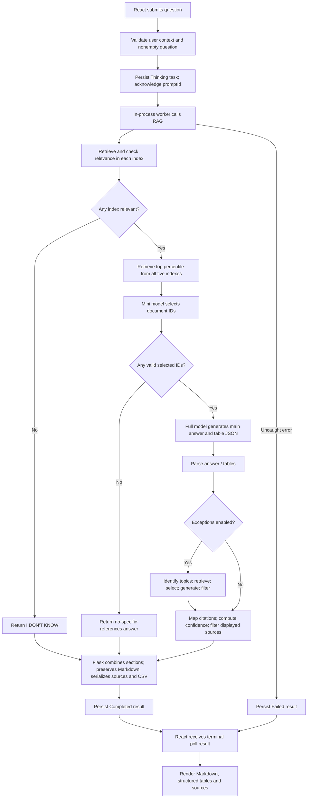

# RAG request process

This guide follows the active execution path from a user question to the React answer. The main entry points are [`backend/app.py`](backend/app.py), [`rag_engine/answer.py`](rag_engine/answer.py), [`rag_engine/engine.py`](rag_engine/engine.py), and [`rag_engine/retrieval.py`](rag_engine/retrieval.py). Architecture/setup are in [README.md](README.md); offline metrics are in [EvalReadMe.md](EvalReadMe.md).

Despite the function name `answer_with_refine_chain`, the current main answer uses a **stuff chain**: selected documents are supplied to one generation call. It does not iteratively refine an answer through the five corpora.

## End-to-end flow



## 1. Frontend submission and API acknowledgement

React's `submit` sends the trimmed input to `/api/ask`. It disables a second submission while its current task is busy/pending. The browser-generated `userId` is included with the question.

The route accepts `question` or the legacy `promptRequestText`. It resolves `userId` (or username/email), rejects missing user context or an empty question, generates a prompt ID and derives a title. It inserts a `Thinking` record into history under the history lock and submits `_complete_ask_prompt` to the four-thread executor. The HTTP response is an acknowledgement containing the task payload; it is not the generated answer.

The worker calls `_run_answer_pipeline`, which starts a timer and calls the lazy public `answer_with_refine_chain` wrapper. Lazy imports allow health/history to work without loading an index or making an API call.

## 2. Index and embedding checks shared by retrieval

Every active retrieval uses the implementation in `rag_engine/retrieval.py`:

1. Require both `index.faiss` and `index.pkl` at the configured directory.
2. Require explicit trust for local pickle deserialization.
3. Read `embedding_manifest.json`; require provider `openai`, the configured model and dimensions.
4. Load FAISS and verify its actual dimension and L2 metric.
5. Reuse the loaded object from a 16-entry cache keyed by path and the artifact/manifest modification timestamps. Changed files invalidate that key.
6. Embed the query with the configured OpenAI embedder. A 256-entry in-memory query cache shares the same vector across indexes and retrieval stages; a lock prevents concurrent duplicate cache-miss requests.
7. Search with `similarity_search_with_score_by_vector`.

For each finite squared-L2 distance `d`, the ranking score is `1 / (1 + max(0, d))`, clamped to `[0,1]`. This is a distance-derived score, not a calibrated relevance probability or cosine similarity. Invalid numeric distances are skipped.

Missing files, incompatible embeddings, permission/trust errors and embedding API failures are errors, not evidence that the user's question is irrelevant. They normally cause the task to fail through the worker exception handler.

## 3. First relevance gate: per-index evidence and semantic decision

`get_query_relevance_llm` runs for each configured corpus, in configuration order, through a pool of up to `rag.relevance_workers` threads. Defaults permit five concurrent checks.

| Part of the check | Exact behavior |
|---|---|
| Numeric retrieval | Fetch up to 20 candidates and retain scores at or above `stage_1` |
| Empty result | Return `irrelevant` without an LLM call |
| `relevance_mode: llm` | Send up to 10 full snippets to the `relevance` model |
| Prompt's acceptance rule | At least one useful snippet **or** an IFRS/IAS/US-GAAP/accounting-treatment question, even with loose snippet relevance |
| Output | Prompt requests JSON with `label` and `reason`; parsing also attempts to extract an embedded JSON object |
| Label handling | Only the normalized exact label `relevant` is accepted; unparseable/empty responses default to irrelevant |
| `relevance_mode: retrieval` | Any nonempty numeric-threshold result is accepted without the semantic judge |

The current numeric threshold is `0.0`; in retrieval-only mode this admits every nonempty index. The LLM prompt is also deliberately permissive for accounting topics, so this stage is not a strict proof that every corpus can answer the question.

**Global gate:** if no corpus returns relevant, the engine returns `I DON'T KNOW`, empty evidence and low confidence. If **any** corpus returns relevant, stage 2 retrieves from **all** configured corpora, including those whose individual stage-1 label was irrelevant. There is no per-corpus exclusion based on those labels in the active path.

## 4. Candidate retrieval across the five corpora

`fetch_docs` retrieves up to **50 candidates per index**, in this order under the supplied configuration: IFRS A, IFRS B, IFRS C, EY, PwC. It keeps the highest-scoring `max(1, int(candidate_count × stage_2_percentile))` results. With 50 candidates and percentile `0.3`, that is 15 per index, up to 75 overall. An empty candidate list still yields no documents.

Each returned document receives a visible source tag, `source_db`, a fresh short `_doc_id`, and `_similarity_score`. Existing metadata is preserved. Source tags use chapter/standard, paragraph and, for relevant publishers, header information. The configured per-database `score_threshold` is stored for compatibility, but this `fetch_docs` path explicitly uses percentile mode instead.

The engine concatenates candidates in corpus order and records offsets. This collection is not a globally reranked list.

## 5. Cross-corpus document selection and ID validation

`_extract_allowed_doc_ids_with_llm` sends the `extractor` model a round-robin preview of at most **55 candidates**, balancing representation across source databases. Each preview contains metadata, the document ID and only the **first 300 characters** of the chunk.

The prompt asks for selected document IDs and a reason. It encourages broad topic inclusion and typically requests 12–25 snippets; that range is a prompt instruction, not a hard count enforced in code. The parser tries direct JSON and then an embedded object.

Returned IDs are intersected with IDs actually present in the candidate collection. `_filter_docs_by_ids` keeps only documents with those valid IDs, in their existing order. Invented IDs cannot select a nonexistent document. Empty/unparseable selection leads to no selected documents; there is no fallback that silently sends all candidates to generation.

If the selection is empty, the engine returns `I couldn't identify specific relevant references for this question.` with no sources/tables and low confidence. This is an ordinary completed answer, distinct from an infrastructure failure.

The 55-document preview and 300-character truncation are material limits: a useful later candidate or information near a chunk's end might not be visible to the selector, even though selected chunks are passed in full to generation.

## 6. Main answer generation

The selected full documents and question go into a LangChain `stuff` summarization chain using the configured **full** model. There is no online DeepEval evaluation at this point.

The main prompt requests context-only accounting analysis, a conclusion followed by introduction and organized sections, relevant illustrations, and no invented reference section. Tables are requested only when the question explicitly asks for them or involves a comparison, with structured columns/rows in trailing JSON.

The model is instructed to append a JSON object containing `answer_text` and/or `tables`. `_split_answer_and_json` attempts to parse that final object; if parsing fails, it keeps the text as the answer body. `_normalize_tables_payload` normalizes valid table objects. The engine prefers JSON `answer_text` when present and removes Markdown tables from free text, because structured tables are delivered separately.

These response-shape requirements are prompt-based, not a schema-enforced main-generation API contract. Malformed wrapping can therefore remain visible as text. The configured maximum output tokens does not enforce an input-context budget; unusually large questions or selected contexts can still exceed model limits.

## 7. Conditional exception, waiver and special-condition workflow

When `rag.exceptions_enabled` is true, the workflow runs **after** the main answer and can add up to four LLM calls:

1. **Topic identification — mini model.** Inspect the question and main answer. Request JSON containing `has_exceptions`, search queries and a reason. Parse failure, no exceptions or no queries returns an empty exception section.
2. **Additional retrieval.** Search up to **five exception queries** against all five corpora using the same 50-candidate/top-percentile `fetch_docs` path. It does not repeat the stage-1 per-index semantic gate for these queries.
3. **Deduplication and relevance selection.** Deduplicate by `_doc_id`, then run the same 55-preview/300-character extractor and strict valid-ID filter, using the original user question. Empty retrieved/selected context ends the branch.
4. **Exception generation — full model.** Use the original question, main answer and selected exception context. The `NO_EXCEPTIONS_FOUND` sentinel removes the section.
5. **Final exception-point relevance check — mini model.** Apply a stricter question-specific filter, requesting at most three critical points. That point limit is a prompt instruction. If it returns `NO_EXCEPTIONS_FOUND`, omit the section; otherwise retain the filtered text and selected exception documents.

Disabling exceptions skips the entire branch. Topic selection and the final exception filter are extra semantic checks with latency and completeness trade-offs.

A current implementation limitation: `fetch_docs` assigns fresh random IDs each time. Deduplicating exception documents by those IDs does not reliably remove the same underlying chunk retrieved by different queries. No content-hash deduplication is implemented in this branch.

## 8. Citations, source display and heuristic confidence

The engine joins main selected documents with retained exception documents, extracts parenthetical citation patterns from the main answer body and exception section, and matches them against source metadata to obtain cited document IDs. Matching is heuristic, not an independent factual-verification step.

It strips a model-generated bold `References` section matching its regular expression. It does **not** call the `strip_inline_citations_with_llm` helper in this active request path, and it does not call `generate_unified_reference_list` to append a separate reference list. Those helpers exist for compatibility but should not be counted as active runtime LLM checks.

All selected documents can become displayed sources, not just those mapped as cited. `filter_page_zero_references` retains only documents with a truthy positive numeric page value. This display filter runs after generation: hidden page-zero chunks may already have influenced the answer. Missing or unsuitable metadata can therefore reduce displayed evidence without removing it from generation.

Confidence is computed without a new API call:

```text
score = 0.50 × mean selected-document retrieval score
      + 0.30 × unique cited IDs / selected-document count
      + 0.20 × min(1, represented source databases / 3)
```

The result is clamped to `[0,1]`. Labels are high at `0.75+`, medium at `0.50+`, otherwise low. This is a retrieval/citation heuristic, **not** calibrated answer accuracy or a DeepEval score. Citation-free answers, parsing differences and citation-matching failures can depress the citation component. Citations placed only inside a parsed JSON `answer_text` can also be missed because main citation extraction currently uses the preceding `answer_body`.

The engine returns the main answer and exception section separately, plus tables, displayed document objects and confidence. Intermediate stage answers are usually empty because the current stuff chain does not produce the historical refinement steps used by that compatibility field.

## 9. Flask response assembly and persistence

`_run_answer_pipeline` appends the exception section to the main answer with blank lines. Some engine comments still say the frontend combines them, but **Flask performs that combination**.

The formatter normalizes newline encodings, optionally applies spreadsheet vocabulary replacements, converts line-start en-dash/bullet markers to Markdown hyphens outside code fences, and preserves headings, indentation, paragraph breaks and code fences. It no longer joins every token into one line or repeatedly bolds already formatted standard names.

The API applies the positive-page source display filter again, normalizes source metadata and produces excerpts up to 900 characters. It converts structured table rows into downloadable CSV payloads, records dimensions, and exposes the first table through the prompt-service compatibility shape. It also records elapsed pipeline time.

The worker updates the existing task with the answer, sources, tables, confidence and `Completed`. Uncaught pipeline exceptions instead store `Failed` with a request-failure message and empty result fields. The request worker does not perform an independent final answer-relevancy, factual-correctness, faithfulness or security judge call.

## 10. Polling and React rendering

`/api/updatestatus` looks up the prompt within the supplied user's history. It accepts an optional wait capped at 60000 ms, checks storage every 0.5 seconds while waiting, and returns the latest record. Nonterminal payloads suggest a 1500 ms retry delay.

React requests waits of 20000 ms and continues until a terminal status, honoring retry hints with a minimum delay. There is no fixed client attempt count that truncates a long task. Reloading restores history and resumes polling pending records, but does not restart a lost server worker.

For completed results, `AnswerMarkdown` renders Markdown and GFM structures; CSS supplies readable headings, paragraphs, lists, block quotes, code and tables. Structured tables render separately with CSV downloads. Source cards display metadata and excerpts. Failed tasks display their failure text. Legacy flattened answers receive only conservative recovery of explicit bold heading markers; exact lost paragraph/list layout requires regeneration.

## 11. Follow-ups, translation and export

- **Follow-up:** the active, last-defined `_resolve_followup_context` finds the referenced question (or latest completed non-Arabic question). The worker concatenates that previous question and the new question, then runs the whole RAG pipeline again. It does not supply the previous answer or a full chat transcript to the model.
- **Translation:** the live route validates a selected completed record and calls the mini model synchronously to translate its answer text while preserving Markdown/standard identifiers by instruction. It updates the same prompt record and sets `isArabic`. It does not rerun retrieval or the answer pipeline. The route's legacy citation cleanup can affect bracketed content; translation is not an independently evaluated answer.
- **Exports:** PDF/HTML exports read stored answers and tables. CSV uses structured payloads in React or the API's Markdown-table conversion route. Exporting does not call a generation model.

`backend/app.py` contains older duplicated helper definitions. Python's last definition is effective; the routes and final helpers described above are the behavior to inspect when changing the system.

## Model-call and check ledger

With five nonempty corpora and no retries:

| Path | Generation/judge calls, excluding embeddings |
|---|---:|
| All relevance labels rejected in LLM mode | Up to 5 relevance calls; no answer generation |
| Accepted question, exceptions disabled | 5 relevance + 1 selector + 1 main answer = **7** |
| Exceptions enabled, topic identification returns none | Previous 7 + 1 topic-identification = **8** |
| Full exception path | Previous 7 + topic identification + exception selector + full exception answer + final mini filter = **11** |
| Retrieval-only relevance mode | Remove the 5 relevance-model calls; document selection and generation remain |
| Arabic translation | 1 mini-model call for the selected response |

Actual counts fall when a branch exits early and increase with SDK retries. Query embeddings are cached independently; exception queries can require additional embeddings. These content checks are not a complete guardrail system: there is no dedicated prompt-injection classifier, moderation endpoint, final answer judge or durable job recovery. Offline metrics can help evaluate changes, but are not an online replacement for those controls.
