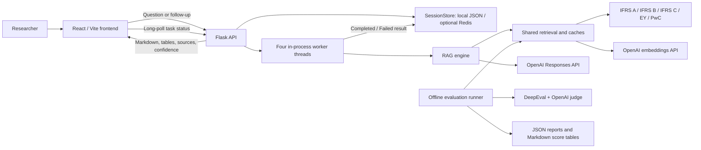

# IFRSHubDigitalCoWorker — Phase 2

An IFRS research application with a React frontend, a Flask API, five FAISS knowledge bases, OpenAI generation and embeddings, and an offline DeepEval workflow. Users can ask accounting questions or submit contract text, inspect supporting excerpts, ask follow-ups, translate a response into Arabic, and export their research.

## Documentation map

| Guide | What it explains |
|---|---|
| **[README.md](README.md)** | Architecture, components, configuration, installation and operations |
| **[RAGReadme.md](RAGReadme.md)** | Every active request stage, relevance check, selection step, generation call and response transformation |
| **[EvalReadMe.md](EvalReadMe.md)** | Dataset design, per-index DeepEval execution, measured results and interpretation |

The diagrams and descriptions follow the executable code. Some legacy comments refer to iterative refinement, citation stripping or asynchronous translation; the current behavior is described in the RAG guide instead.

## Architecture



The Flask API acknowledges answer requests before the work finishes. It stores a `Thinking` task and submits generation to an in-process executor. React polls until `Completed` or `Failed`; this is task polling, not token streaming. DeepEval is a separate command and never runs inside normal answer requests.

### Component responsibilities

| Location | Responsibility |
|---|---|
| `frontend/src/main.jsx` | Workspace UI, history, question submission, follow-ups, translation and exports |
| `frontend/src/api.js` | API requests, long polling, abort handling and file downloads |
| `frontend/src/AnswerMarkdown.jsx` | Markdown/GFM rendering and scrollable tables |
| `frontend/src/answer-markdown.js` | Conservative heading recovery for older flattened answers |
| `backend/app.py` | HTTP contracts, task lifecycle, result assembly and export routes |
| `backend/session_store.py` | File-backed history, optionally using Redis with file fallback |
| `rag_engine/config.py` | YAML loading, environment expansion and path resolution |
| `rag_engine/retrieval.py` | Trusted FAISS loading, embedding compatibility, ranking and caches |
| `rag_engine/engine.py` | Relevance decisions, cross-corpus selection, main answer, exceptions, citations and confidence |
| `rag_engine/llm_client.py` | LangChain-compatible OpenAI Responses adapter and task routing |
| `rag_engine/formatting.py`, `tables.py` | Preserve answer Markdown; parse and normalize tables |
| `rag_engine/translate.py`, `exports.py` | Arabic translation and PDF/HTML exports |
| `scripts/rebuild_indexes.py` | Re-embed an existing trusted LangChain docstore into a new OpenAI-compatible index |
| `evaluation/run_eval.py`, `judge.py` | Independent per-index retrieval evaluation and schema-constrained judge calls |
| `tests/`, `frontend/tests/` | Offline regression checks and Markdown compatibility tests |

`rag_engine/answer.py` provides the lazy public answer interface. Root `llm_client.py` and `rag_config.py` remain compatibility imports for the existing engine.

## Models and configuration

[`Config.yaml`](Config.yaml) is the canonical configuration. `backend/config.yaml` points to it for older launch configurations. Set `RAG_ENGINE_CONFIG` to an alternate YAML file and restart the server to load it. `${ENV_NAME:default}` values are expanded after loading the root `.env`. Relative corpus paths resolve from the project root.

| Task | Model in configuration | Maximum output tokens | Reasoning effort |
|---|---|---:|---|
| Main answer and exception generation | `gpt-6.1-sol` | **128000** | `medium` |
| Translation, exception topic identification and final exception filtering | `gpt-6-luna` | 8192 | `low` |
| Document selector (`extractor`) | `gpt-6-luna` | 8192 | `low` |
| Per-index relevance judge | `gpt-6-luna` | 1024 | `low` |
| Query/document embeddings | `text-embedding-3-small` | Not a generation task | 1536 dimensions |

The generation adapter sends the configured model, `max_output_tokens`, reasoning effort and `store=false`. It preserves system/user/assistant roles and rejects incomplete or empty responses. The configured API timeout is 600 seconds with two SDK retries. It omits temperature. The 128000 setting is an output ceiling including reasoning, not an input/context allocation or a promise of output length.

These are project settings, not an assertion that every OpenAI account has access to those models. Model or account errors propagate into a failed task; there is no silent provider/model substitution.

### Important controls

| Setting | Current behavior |
|---|---|
| `rag.relevance_mode: llm` | Keep the per-index semantic relevance checks |
| `rag.relevance_workers: 5` | Run those checks concurrently, up to five at a time |
| `rag.thresholds.stage_1: 0.0` | A permissive numeric threshold before semantic checking |
| `rag.thresholds.stage_2_percentile: 0.3` | Keep the top 30% of up to 50 candidates from each corpus |
| `rag.exceptions_enabled: true` | Run the conditional exception/waiver workflow |
| `rag.trust_local_indexes` | Explicitly permit loading your trusted local LangChain pickle files |
| `session.provider` | `file` by default; `redis` attempts Redis and still writes file history |
| `evaluation.*` | Judge task, threshold, dataset and bounded metric concurrency |

The RAG guide explains what the relevance settings actually accept and which subsequent checks remain active.

## Local setup

Use Python **3.11** and Node **20.19+**. Keep the environment isolated from globally installed ML packages.

```bash
python3.11 -m venv .venv
source .venv/bin/activate
python3.11 -m pip install -r backend/requirements.txt
cp .env.example .env
```

Set `OPENAI_API_KEY` in the root `.env`. The key stays on the backend; never put it in a `VITE_` variable. `.env.example` intentionally contains no key. Health checks and the UI can start before credentials and corpora are provisioned.

### Prepare the knowledge bases

The GitHub source repository excludes local FAISS indexes, licensed corpus documents, chat history, environments and generated build files. Provision the five corpora separately. Each configured directory must contain:

```text
index.faiss
index.pkl
embedding_manifest.json
```

The loader checks the manifest's OpenAI provider, embedding model and dimensions, checks the FAISS dimension and L2 metric, and requires `rag.trust_local_indexes: true` for your own trusted files. File presence in `/api/health` is only an availability indicator; search performs the compatibility checks.

An index produced with MiniLM cannot be migrated just by changing the query embedder. Rebuild each existing trusted docstore into a **new** directory:

```bash
python3.11 scripts/rebuild_indexes.py \
  --source '/absolute/path/to/trusted/legacy/EY_embed_test' \
  --output './EYKnowledgeBase/EY' \
  --trust-source
```

The script checks output-folder writability before embedding, preserves document metadata, writes the manifest and refuses an existing destination. Update `rag.db_paths` for each corpus. Use a project-relative output such as `./EYKnowledgeBase/EY`; `/EYKnowledgeBase/EY` targets the filesystem root. Original indexes are left untouched.

The current path conventions are `IFRSAKnowledgeBase/IFRSA`, `IFRSBKnowledgeBase/IFRSB`, `IFRSCKnowledgeBase/IFRSC`, `EYKnowledgeBase/EY`, and `PwCKnowledgeBase/PwC`; you may configure other locations. An optional `Replacement_data.xlsx` supplies vocabulary substitutions; its absence does not prevent startup.

### Launch the backend

```bash
source .venv/bin/activate
python3.11 -m backend.app
```

The default API address is `http://127.0.0.1:3000`; the bind host and default port come from YAML, with `PORT` taking precedence. Debug mode is off by default.

### Launch the frontend

In a second terminal:

```bash
cd frontend
npm ci
npm run dev
```

Open the printed local URL, normally `http://127.0.0.1:5173`. Vite proxies `/api` to port 3000. Set shell variable `FLASK_API_URL` to change the development proxy target. `VITE_API_BASE_URL` is an optional browser-visible API URL for builds served separately; configure the matching exact CORS origin in YAML.

```bash
npm --prefix frontend run build
```

This creates `frontend/dist`. A deployment needs a static web server for that directory and either an `/api` reverse proxy or an explicit API URL. Flask's development server and in-process executor are the current local runtime; deployment, durable worker queues and authentication are separate integration work.

## API contract

Answer routes return an envelope with `success`, `errors`, `code` and `payload`. The payload carries `promptId`, `promptStatus`, `isTerminal`, `retryAfterMs`, `promptResponseText`, tabular content and `renderData`.

| Route | Input / purpose |
|---|---|
| `GET /api/health` | Connection status, model configuration, key-presence boolean and index-file availability |
| `GET /health` | Minimal health alias |
| `POST /api/ask` | `{userId, question}` creates a task |
| `POST /api/followup` | `{userId, question, promptId}` creates a task linked to a previous prompt |
| `POST /api/updatestatus` | `{userId, promptId, waitForTerminalMs}` fetches/long-polls that user's task |
| `GET /api/history?userId=...` | Restore stored research |
| `POST /api/translate` | `{userId, promptId}` translates the selected completed response synchronously |
| `POST /api/clear` | `{userId}` removes that workspace's history |
| `POST /api/export/pdf`, `/api/export/html` | `{userId}` exports stored history |
| `POST /api/export/csv` | Converts supplied `{table_markdown, table_index}` into a CSV download |

React also downloads structured table CSV directly from the provided CSV payload. Its Markdown rendering is richer than the current export implementation; do not assume PDF/HTML exports reproduce every frontend style.

## Persistence and operational boundaries

React stores a generated workspace ID in browser local storage. That ID identifies history; it is **not an authenticated identity**. The backend also accepts legacy username/email payloads. Add authorization before using workspace IDs as multi-user access controls.

History defaults to `backend/chat_history`. Redis, when selected, is attempted with two-second socket timeouts; file fallback remains available and saves still write JSON. The implementation currently uses the fixed `ifrs:history:` Redis prefix. The YAML `key_prefix` field is not consumed by the store.

Four worker threads and the history lock are process-local. Persisting a `Thinking` record does not make the job durable: a server restart can leave it pending, and browser reload only resumes polling. Multiple server processes do not share the file-history lock. Application logs currently include questions and some generated/retrieved text.

No runtime DeepEval judge, separate answer-factuality judge, moderation API or dedicated prompt-injection classifier is wired into this implementation. Current relevance checks are content-selection controls, and the displayed confidence is a retrieval heuristic. See the exact boundaries in [RAGReadme.md](RAGReadme.md).

## Evaluation and verification

Follow [EvalReadMe.md](EvalReadMe.md) for real retrieval scores, dataset provenance and commands. The recorded October 22, 2026 contract run completed fifteen metric evaluations; it did not pass every threshold. Do not confuse those measured scores with unit-test fixtures or final-answer accuracy.

```bash
python3.11 -m pip install -r evaluation/requirements.txt
python3.11 -m pytest tests -q
node --test frontend/tests/answer-markdown.test.js
npm --prefix frontend run build
python3.11 evaluation/run_eval.py --inventory-only
```

Tests use mocked OpenAI responses and temporary fixture indexes. Inventory makes no embedding/judge requests. A scored evaluation or index rebuild uses your configured API credentials and incurs API usage. See the [dataset guides](evaluation/README.md) for the supplied IFRS 15 and serviced-office scenarios.
